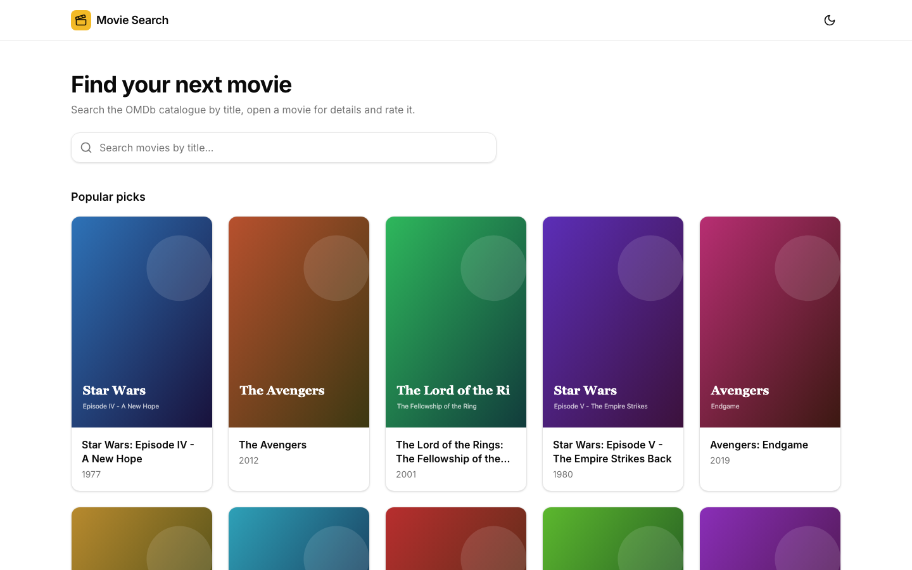
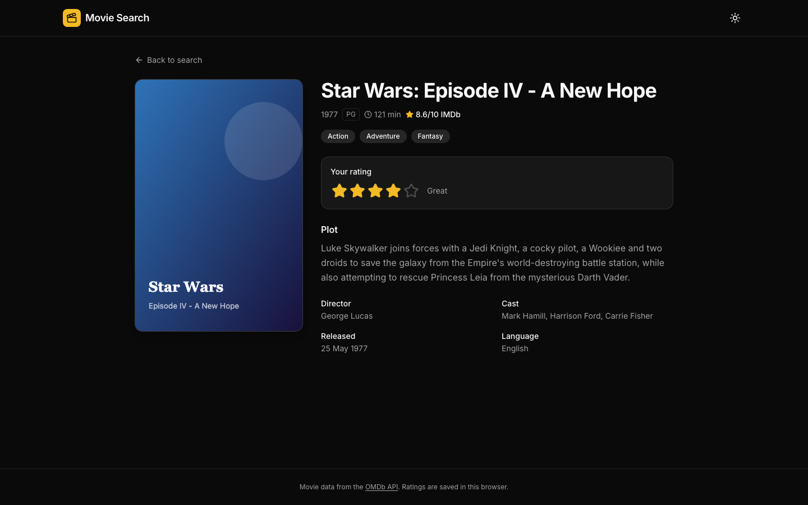
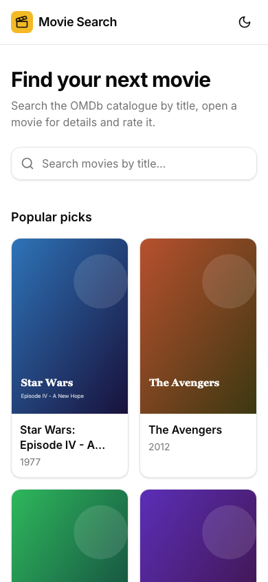

# Movie Search (OMDb)

A responsive movie search app built with Next.js 15, React 19 and the OMDb API. Search titles as you type, open a movie's details and give it a 1-5 star rating.


[](https://github.com/VamsiKrishnaThota03/movie-imdb/actions/workflows/ci.yml)
[](https://github.com/VamsiKrishnaThota03/movie-imdb/actions/workflows/codeql.yml)
[](LICENSE)

## Live demo

**https://movie-imdb-omega.vercel.app/movies**

| Search (light) | Movie detail (dark) | Mobile |
| --- | --- | --- |
|  |  |  |

_Screenshots use sample data with generated posters._

## Overview

The app uses the Next.js App Router, and `/` redirects to `/movies` on the server. The movies page starts with a grid of popular titles (mixed results for "star wars", "avengers" and "lord of the rings"). Typing in the search bar searches [OMDb](https://www.omdbapi.com/) once you have entered at least 3 characters, with a 400 ms debounce, and fetches up to two result pages (about 20 movies).

The browser never talks to OMDb directly: it calls the app's own route handlers (`/api/movies`, `/api/movies/[id]`), which add the API key on the server and cache OMDb responses for an hour. TanStack Query handles fetching and client caching; Redux Toolkit holds the search term and your ratings.

## Features

- **Live, debounced search:** searches as you type (400 ms debounce, minimum 3 characters) with a clear button; the query is kept when you go back from a movie
- **Initial suggestions:** a grid of 15 popular movies before you search
- **Movie detail page** (`/movies/[id]`): poster, year, rating certificate, runtime, IMDb score, genres, director, cast, release date, language and full plot
- **Star rating (1-5):** keyboard-accessible star picker; click the same star again to clear. Ratings are saved in `localStorage` and shown as a badge on movie cards.
- **Light/dark theme toggle:** `next-themes`, defaults to the OS preference
- **Loading skeletons**, empty results and error states with retry (including a clear message when the server has no API key)
- **Server-side API key:** `OMDB_API_KEY` is only read by route handlers, and inputs (search term length, IMDb id format, page) are validated
- **Responsive grid** built with Tailwind CSS 4 and shadcn/ui-style components (`lucide-react` icons)

## Tech stack

| Area | Tools |
| --- | --- |
| Framework | Next.js 15 (App Router, route handlers, Turbopack dev), React 19, TypeScript |
| Data | TanStack Query 5, axios, OMDb API |
| State | Redux Toolkit, React Redux |
| UI | Tailwind CSS 4, `next-themes`, shadcn/ui components (`@radix-ui/react-slot`, `class-variance-authority`, `tailwind-merge`), `lucide-react` |
| Hosting | Vercel |

## Project structure

```
movie-imdb/
├── public/                      # placeholder poster
└── src/
    ├── app/
    │   ├── page.tsx             # redirects to /movies
    │   ├── api/movies/route.ts       # GET /api/movies?q=&page=  (OMDb search proxy)
    │   ├── api/movies/[id]/route.ts  # GET /api/movies/:imdbId (OMDb details proxy)
    │   ├── movies/page.tsx      # search + results grid
    │   └── movies/[id]/page.tsx # movie details + rating
    ├── components/
    │   ├── movies/              # MovieCard, MovieGrid, SearchBar, StarRating
    │   ├── providers/           # next-themes, Redux and React Query providers
    │   ├── SiteHeader.tsx, Notice.tsx
    │   └── ui/                  # button, card, input, skeleton
    └── lib/
        ├── api/movies.ts        # client calls to the app's API routes
        ├── server/omdb.ts       # server-side OMDb client (reads OMDB_API_KEY)
        ├── hooks/useDebounce.ts
        └── store/               # Redux store and movie slice (search term, ratings)
```

## Getting started

### Prerequisites

- Node.js 18.18+ (required by Next.js 15) and npm
- An OMDb API key ([get one free](https://www.omdbapi.com/apikey.aspx))

### Install and run

```bash
git clone https://github.com/VamsiKrishnaThota03/movie-imdb.git
cd movie-imdb
npm install
cp .env.example .env.local   # then set OMDB_API_KEY
npm run dev            # http://localhost:3000
```

### Environment variables (`.env.local`)

| Variable | Required | Description |
| --- | --- | --- |
| `OMDB_API_KEY` | Yes | OMDb API key, read only on the server by the `/api/movies` route handlers. Without it the app shows a configuration error. |

For older deployments the server also falls back to `NEXT_PUBLIC_OMDB_API_KEY`, but it is no longer used in browser code. Prefer `OMDB_API_KEY`.

### Scripts

| Command | Description |
| --- | --- |
| `npm run dev` | Dev server with Turbopack |
| `npm run build` | Production build |
| `npm start` | Serve the production build |
| `npm run lint` | Next.js ESLint |

## Known limitations

- Ratings are stored per browser in `localStorage`; there are no accounts or sync.
- Search covers movies only (`type=movie`) and shows at most the first two OMDb pages.
- The free OMDb tier allows 1,000 requests per day; responses are cached for an hour to stay under it.


## How the OMDb key is protected

The key is read **only** in `src/lib/server/omdb.ts`, which runs server-side,
and the browser talks to `/api/movies` instead of calling OMDb directly. That
keeps the key out of the client bundle — and CI asserts it, by building with a
known placeholder value and then grepping `.next/static` for it. A
`NEXT_PUBLIC_` prefix on the key, or a stray import of the server module into a
client component, would both fail that check.

Hiding the key stops it being *stolen*. It does not stop it being *spent* — the
deployed app is the key, so anyone who finds the URL could have called
`/api/movies` in a loop and burned the free tier's 1,000 requests a day. Both
route handlers are now rate limited per caller (30 requests/minute), and the
limiter runs **before** validation, so a stream of deliberately invalid queries
cannot be free either.

`clientKey()` reads the **first** `x-forwarded-for` entry, not the last. That
detail is the difference between a working limit and a decorative one: Vercel
appends the real client as the first entry, so reading the last would let a
caller send their own `x-forwarded-for` and pick a fresh bucket at will. There
is a test for it.

The counter is an in-process fixed window. The trade-off is stated plainly
rather than hidden: serverless instances do not share memory, so the effective
limit is per instance and a burst spread across cold starts can exceed it. For
protecting a free quota on a demo that is the right size of solution; a hard
global limit would need Redis or Vercel KV.

## Security headers

`next.config.ts` sets a CSP plus `nosniff`, `strict-origin-when-cross-origin`,
`X-Frame-Options: DENY`, HSTS and a `Permissions-Policy` denying camera,
microphone and geolocation. `poweredByHeader` is off.

`script-src` has to include `'unsafe-inline'`: Next injects inline bootstrap
scripts and `next-themes` writes one to apply the saved theme before first
paint. Removing it would need a nonce threaded through the document via
middleware. That is documented in the config rather than glossed over, so the
policy is not mistaken for being stricter than it is. `connect-src` is `'self'`
only, since the browser never calls OMDb.

## Tests

```bash
npm run test:run       # 49 tests
npm run test:coverage
```

| Suite | Covers |
| --- | --- |
| `rateLimit.test.ts` | Counting, per-caller isolation, window reset, `retryAfter` never rounding to 0 while blocked, eviction of expired windows, and that `clientKey` takes the first `x-forwarded-for` entry and never returns an empty key |
| `omdb.test.ts` | The 503 for a missing key, the key being sent as a query param, the legacy `NEXT_PUBLIC_` fallback, network failure → 502, a rejected key → 502 rather than a bare 401, and that **no error message ever contains the key** |
| `route.test.ts` | Validation rejecting short/long/whitespace terms and bad pages *without calling OMDb*; `"Movie not found!"` becoming an empty result set rather than an error; a malformed `Search` field; `OmdbError` statuses propagating; an unexpected exception becoming a 500 with no `ECONNREFUSED` or internal host leaked; and the limiter returning 429 with `Retry-After` while sparing the quota |
| `movieSlice.test.ts` | Rating set/clear/clamp/round, other movies' ratings surviving, and `loadRatings` surviving malformed JSON, non-object values and out-of-range entries — `localStorage` is user-writable, so all of that is reachable |

## Continuous integration

| Job | What it proves |
| --- | --- |
| `test` (Node 20, 22) | ESLint, `tsc --noEmit`, 49 tests, plus coverage on 20 |
| `build` | A production build; that the API key is absent from `.next/static`; and that the security headers are still configured in `next.config.ts` |

CodeQL runs weekly and on every push; Dependabot groups weekly patch/minor bumps.

## A note on tooling

`lint` was `next lint`, which Next.js 15 deprecates and Next.js 16 removes. It
now calls the ESLint CLI directly. That required adding an `ignores` block to
`eslint.config.mjs` — `next lint` excluded `.next/`, `node_modules/` and
generated type files implicitly, and without them the CLI walks the build output
and reports thousands of findings in generated code.
